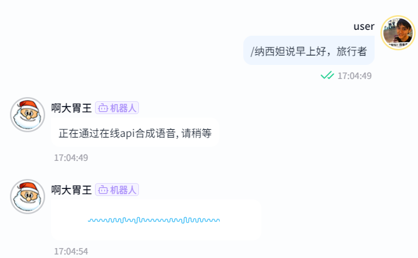

<div align="center">

# nonebot-plugin-fishspeech-tts

<a href="https://v2.nonebot.dev/store">
</a>

_⭐基于Nonebot2的调用在线[fish-audio](https://fish.audio/)或离线[fish-speech](https://github.com/fishaudio/fish-speech) api⭐_
_⭐文本生成语音`tts`插件⭐_

<a href="https://www.python.org/downloads/release/python-390/">
    </a>
<a href="https://qm.qq.com/q/SL6m4KdFe4">
    </a>
<a href="https://github.com/Cvandia/nonebot-plugin-game-torrent/blob/main/LICENCE">
    </a>
<a href="https://v2.nonebot.dev/">
    </a>
<a href="https://github.com/Cvandia/nonebot-plugin-fishspeech-tts/actions/workflows/python-app.yml">
    </a>

**中文简体** | [**English**](./docs/README_EN.md)

</div>

---

## ⭐ 介绍

[](https://github.com/user-attachments/assets/75fa16e0-f340-4bbe-9c58-ef4062ee76ac)

**仅需一条5秒语音素材，就可~~完美~~优秀克隆素材本音呐！**
只需要准备好你想克隆的角色语音，并对其语音进行文件名的标注(见下文)，就可以快速生成语音。
> 或者使用官方在线api -> [fish-audio](https://fish.audio/)即可享受快速云端的语音生成。

## 📜 免责声明

> [!CAUTION]
> 本插件仅供**学习**和**研究**使用，使用者需自行承担使用插件的风险。作者不对插件的使用造成的任何损失或问题负责。请合理使用插件，**遵守相关法律法规。**
使用**本插件即表示您已阅读并同意遵守以上免责声明**。如果您不同意或无法遵守以上声明，请不要使用本插件。

---

## 💿 安装

<details>
<summary>安装</summary>

`pipx` 安装

```bash
pipx install nonebot-plugin-fishspeech-tts -U
```
> [!note] 在nonebot的pyproject.toml中的plugins = ["xxx"]添加此插件

`nb-cli`安装
```bash
nb plugin install nonebot-plugin-fishspeech-tts -U
```

`git clone`安装(不推荐)

- 命令窗口`cmd`下运行
```bash
git clone https://github.com/Cvandia/nonebot-plugin-fishspeech-tts
```
- 在窗口运行处
将文件夹`nonebot-plugin-fishspeech-tts`复制到bot根目录下的`src/plugins`(或创建bot时的其他名称`xxx/plugins`)


 </details>

 <details>
 <summary>注意</summary>

 推荐镜像站下载

 清华源```https://pypi.tuna.tsinghua.edu.cn/simple```

 阿里源```https://mirrors.aliyun.com/pypi/simple/```

</details>

## ⚙️ 配置

**在.env中添加以下配置**

|      基础配置      |  类型   | 必填项 |      默认值       |                            说明                             |
| :----------------: | :-----: | :----: | :---------------: | :---------------------------------------------------------: |
|   tts_is_online    |  bool   |   是   |       True        |                       是否使用云端api                       |
|  tts_chunk_length  | literal |   否   |     "normal"      | 请求时音频分片长度，默认为normal，可选：short, normal, long |
| tts_max_new_tokens |   int   |   否   |       None        |          每个文本分片的 token 上限；不配置时采用服务端默认值，0 的含义由后端决定          |
|   tts_audio_path   |   str   |   否   | "./data/参考音频" |            语音素材路径，默认为"./data/参考音频"            |
|     tts_prefix     |   str   |   否   |       None        | 合成指令前缀；None 使用全部 COMMAND_START，空字符串表示无前缀 |

**注：参考音频的文件名格式为：［角色名］音频对应的文字标签.[音频后缀名]**

点击[这里](https://github.com/Cvandia/nonebot-plugin-fishspeech-tts/releases)可选择下载推荐参考音频`reference_audio.zip`，解压并把音频并放入bot文件目录的`data/参考音频`下即可

**! 支持同一角色的不同语音 !**

**音频后缀目前支持有详见[files.py](./nonebot_plugin_fishspeech_tts/files.py)中的`AUDIO_FILE_SUFFIX`**
___

如果你想使用官方的api，请将配置项`tts_is_online`设置为`True`并配置以下

|        配置项        | 类型  | 必填项 |           默认值            |                                                                                     说明                                                                                     |
| :------------------: | :---: | :----: | :-------------------------: | :--------------------------------------------------------------------------------------------------------------------------------------------------------------------------: |
|    online_api_url    |  str  |   否   | "https://api.fish.audio" |                                                                                 官方 API 根地址；可显式配置其他兼容服务                                                                                  |
| online_authorization |  str  |   是   |            None             |                                                    官网api鉴权秘钥，详见[链接](https://fish.audio/zh-CN/go-api/api-keys/)                                                    |
|  online_model_first  | bool  |   否   |            True             | 如果你想调用官方模型，通过自己的参考音频，定制角色音色，将此项设为`False`。当然，如果你没有准备参考音频，也会调用官网已经有的音色，具体详见[链接](https://fish.audio/zh-CN/) |
|   online_api_proxy   |  str  |   否   |            None             |                                                                     代理地址，如：http://127.0.0.1:7890                                                                      |

---

如果你想使用[自搭](#自建-fish-speech-服务)或者其他的[fish-speech](https://github.com/fishaudio/fish-speech)项目的api,请将配置项`tts_is_online`设置为`False`并配置以下

|     配置项      | 类型  | 必填项 |         默认值          |           说明           |
| :-------------: | :---: | :----: | :---------------------: | :----------------------: |
| offline_api_url |  str  |   是   | "http://127.0.0.1:8080" | 你的`fish-speech`api地址 |

## 当前 API 兼容配置（2026-10-19）

云端 TTS 仍调用 `POST /v1/tts`，音色 ID 与基础合成模型是两个不同概念。

| 配置项 | 类型 | 默认值 | 说明 |
| --- | --- | --- | --- |
| online_model | str | `s2.1-pro` | `model` 请求头；支持 `s2.1-pro-free`、`s2-pro`、`drama-3` 和仍在迁移期的 `s1` |
| online_language | str 或 None | None | 新增的 BCP-47 文本语言提示，如 `zh-CN`；影响数字等文本归一化，不改变音色或口音 |
| online_reference_ids | dict[str, str] | `{}` | 角色名到云端音色 ID 的映射，优先于名称搜索；在 `online_model_first=True` 时使用 |
| offline_authorization | str 或 None | None | 本地服务 `--api-key` 对应的 Bearer 密钥 |
| offline_reference_ids | dict[str, str] | `{}` | 角色名到服务端已保存参考音色的映射；命中后无需上传本地音频 |
| offline_single_chunk | bool | False | 本地 Drama 3 的整段生成开关；其他模型保持 False |
| tts_is_stream | bool | False | 本地是否请求流式 WAV；插件仍收齐音频后发送语音，不提供边生成边播放 |

`.env` 示例（需要填写自己的 API 密钥和音色 ID）：

```dotenv
TTS_IS_ONLINE=true
ONLINE_API_URL=https://api.fish.audio
ONLINE_AUTHORIZATION=your-api-key
ONLINE_MODEL=s2.1-pro
ONLINE_LANGUAGE=zh-CN
ONLINE_REFERENCE_IDS={"角色名":"your-voice-model-id"}
```

发送 `角色名说[轻声]你好`，方括号内的语气指令会保留并交给模型处理。
如需免费开发模型，可将 `ONLINE_MODEL` 显式设为 `s2.1-pro-free`；是否可用及额度以官网为准。默认 `s2.1-pro` 使用账户的付费 API 额度。

旧版 `speech-1.5`、`speech-1.6` 已退役；`s1` 将于 2026-12-31 退役。
升级后默认官方域名变为 `api.fish.audio`、本地端口统一为 `8080`；原有部署若使用其他域名或端口，请保留显式配置。
未设置 `tts_max_new_tokens` 时不再硬编码旧版 800 上限，已显式设置的数值继续生效。
参考音频走 MessagePack，云端音色 ID 请求走 JSON。HTTP 鉴权、余额不足、限流等错误会作为文字提示返回。

官方依据：[TTS API](https://docs.fish.audio/api-reference/endpoint/openapi-v1/text-to-speech)、[更新记录](https://docs.fish.audio/developer-guide/getting-started/changelog)、[模型退役说明](https://docs.fish.audio/developer-guide/models-pricing/deprecations)、[本地请求结构](https://github.com/fishaudio/fish-speech/blob/main/fish_speech/utils/schema.py)。

## ⭐ 使用

### 在线聊天体验

[打开语音体验站](https://fishspeech-chat-demo.arcane-krill-2332.chatgpt.site) · [网站源码与部署说明](web-demo/README.md)

访客使用自己的 Fish Audio API 密钥，默认可莉音色，固定免费模型 `s2.1-pro-free`。像聊天一样发送文字或 `/可莉说[激情]你好呀`，接收可播放、可下载的语音。密钥不写入浏览器持久存储，刷新页面后清除；调用会经体验站代理转发到官方 API。

> [!note]
> 请注意你的 `COMMAND_START` 以及上述配置项。

所有指令均使用 `nonebot-plugin-alconna` 响应与解析（需要 >=0.62.1）。
合成指令保持 `角色名说文本` 写法，例如 `/可莉说[轻声]你好`；正文中的空格、引号、换行和方括号标签会原样保留。
回复一条消息后发送 `/可莉说`，可合成被回复的文字。`tts_prefix` 仅覆盖合成指令的前缀，角色列表和余额查询继续使用 `COMMAND_START`。

### 指令：

|   指令   |  需要@   | 范围  |       说明       | 权限  |
| :------: | :------: | :---: | :--------------: | :---: |
| xxx说xxx | 根据配置 |  all  |   tts语音生成    |  all  |
| 语音列表 |    是    |  all  | 获取所有角色列表 |  all  |
| 语音余额 |    是    |  all  |   查询api余额    |  all  |

## 🌙 Todo
 - [x] 添加更多配置项
 - [ ] 暂无计划

<center>喜欢记得点个star⭐</center>

## 💝 特别鸣谢

- [x] [nonebot2](https://github.com/nonebot/nonebot2): 本项目的基础，非常好用的聊天机器人框架。
- [x] [fish-speech](https://github.com/fishaudio/fish-speech):零样本 & 小样本 TTS：输入 10 到 30 秒的声音样本即可生成高质量的 TTS 输出


## ⭐ 额外帮助

### 自建 fish-speech 服务

先按 [官方安装文档](https://github.com/fishaudio/fish-speech/blob/main/docs/en/install.md) 安装环境并下载模型权重，再按 [服务端文档](https://github.com/fishaudio/fish-speech/blob/main/docs/en/server.md) 启动 API。以 S2-Pro 为例：

```bash
python tools/api_server.py --llama-checkpoint-path checkpoints/s2-pro --decoder-checkpoint-path checkpoints/s2-pro/codec.pth --listen 127.0.0.1:8080
```

使用 `GET http://127.0.0.1:8080/v1/health` 检查服务。
插件配置 `TTS_IS_ONLINE=false` 和 `OFFLINE_API_URL=http://127.0.0.1:8080`，参考音频沿用 `[角色名]文本.wav` 命名。
如果服务启用了 `--api-key`，同时设置 `OFFLINE_AUTHORIZATION`。
本地基础模型由服务器加载的权重决定，不使用 `ONLINE_MODEL`；`reference_id` 仅选择保存的参考音色。

### 开发验证

```bash
uv venv
uv pip install -e . --group dev
uv run --no-project pytest -q
uv run --no-project ruff check .
```

回归测试使用模拟 HTTP 响应，不需要 API 密钥，也不会调用计费合成服务；真实音质和模型可用性需在实际后端验证。
